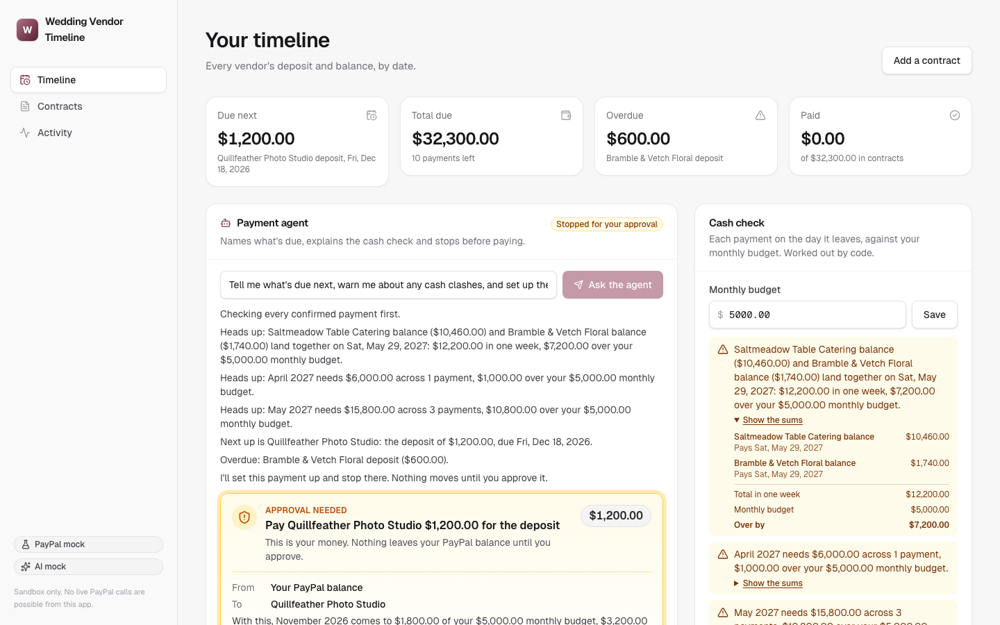

# Wedding Vendor Timeline

> For couples juggling wedding vendors: Claude reads each vendor contract, you confirm every deposit and balance on one timeline, and PayPal pays the vendor once you approve it.

**Live demo:** https://vendor-timeline.onrender.com <!-- TODO: update after deploy --> · **Video (≤3 min):** <!-- TODO: YouTube link --> · **License:** MIT

 <!-- TODO: add a 1440×900 screenshot of the main flow -->

## The problem

A wedding means five or more vendors, each with its own contract, its own wording and its own deadlines. One says "25% to hold the date", another "the rest two weeks before your wedding", another buries the balance in a schedule. Couples track these in their heads or a spreadsheet, and a missed deposit can cost them the vendor. Worse, the sums in contracts aren't always right.

## What it does

- **Add contracts.** Paste the text, upload a `.txt` or `.pdf` file, try one of the five fictional samples or the sample PDF, or load all five at once from the timeline.
- **AI reads the payment terms.** Vendor, total, deposit and date, balance and date, each with the exact contract sentence it came from.
- **You check them.** Terms sit beside their source sentences. You confirm or edit. Anything missing or unclear is flagged and left blank, and nothing reaches the timeline unconfirmed.
- **One timeline.** Every deposit and balance by date and as bars per vendor, what's due next, what's overdue and the total due. Dates can be moved, and the original stays on the row.
- **Cash warnings.** Code puts each payment on the day its money leaves and checks it against your monthly budget ($5,000 unless you change it): payments landing in the same week, and months that go over. Each warning opens to show the sums.
- **Ask the agent.** The payment agent names the next payment, explains the warnings, sets the payment up and stops. It can't pay on its own.
- **Pay photographer.** A person approves it, then PayPal sends it. The Pay button goes through the same tool as the agent.
- **Proof.** The item is marked paid only when PayPal says so about that exact payment, shown with the PayPal ids and the webhook event.

## How PayPal is used

All PayPal calls go to the **sandbox** (`https://api-m.sandbox.paypal.com`); there is no live mode in the code. Every call shows on the in-app timeline with its HTTP status and PayPal `debug_id`.

| PayPal API | Endpoint(s) | Where and why |
|---|---|---|
| Payouts | `POST /v1/payments/payouts`, `GET /v1/payments/payouts/{id}` | Sends the vendor its deposit or balance, after a person approves. A batch finishes after a short wait, so the app re-reads it until the item's real status comes back. |
| Webhooks | `POST /v1/notifications/verify-webhook-signature` | A verified `PAYMENT.PAYOUTS-ITEM.*` event is tied to one payment by batch id and `sender_item_id`, then checked against that payment's amount, currency and receiver. Anything that doesn't match changes nothing. Events for batches this app didn't create are dropped, because PayPal doesn't filter payouts per app. |

**Sandbox stand-in:** the sample vendors are fictional, and a payout to an address with no PayPal account stays UNCLAIMED. So in sandbox each payout goes to a PayPal test account standing in for the vendor, and the app says so on screen. The money is meant to be the couple's own: the approval card says "From: Your PayPal balance", and in sandbox the app's business account stands in for that balance and says so too. A real launch would have each couple connect their own PayPal, which isn't built.

**Paid status:** an item turns Paid when a verified webhook for that payment and PayPal's own re-read both say SUCCESS. If no webhook arrives within 60 seconds of the re-read's SUCCESS, the re-read stands and the item says "Confirmed by PayPal re-read" instead. That's what a local copy shows, since PayPal can only reach the hosted one.

**Safety around money:** every payment goes through a guard. It enforces a per-action cap, a daily cap, a payee allowlist and idempotency, and `create_vendor_payout` always waits for a person. The tool takes a contract, a kind and an amount, never a receiver. Code refuses the call before any approval is created unless the amount exactly matches a confirmed term for that couple's contract, so an agent asking for too much gets a refusal, not a prompt. The payout itself is built from the confirmed terms on the server. Every decision goes to a hash-chained, append-only audit log.

## How AI is used

| Where | Model | What it does |
|---|---|---|
| Reading a contract | Claude Haiku 5.5 (`claude-haiku-5-5`) | Copies each payment term and its source sentence out of the contract text |
| Payment agent | Claude Haiku 5.5 (`claude-haiku-5-5`) | Explains what code worked out, then asks for the next payment through the guarded tool |

- **Copying, not arithmetic**: the model copies figures and sentences. Code turns percentages into cents and relative dates into calendar days, and works out every balance and total. If a contract states a balance that doesn't match, it's flagged.
- **Checked against the contract**: code confirms each sentence really is in the contract and each figure or date really is in its sentence.
- **The agent explains, code decides**: `review_payments` hands the agent the next payment and the cash warnings as finished sentences, so it has no sums to do. The same tool shows the couple each warning directly, so a warning can't be left out by the model. Limits live in the tool, not the prompt.
- **Structured output**: zod schemas through the Messages API's structured outputs (`output_config.format`).
- **Cost control**: a hard daily spend cap (worst case reserved before every call), per-IP rate limits, and Haiku by default.
- **Mock mode**: without an API key the app uses clearly labelled simulated reads of the sample contracts and a scripted agent, so the demo works anywhere.

**Built with AI.** This project was built with **Claude Code** (Anthropic's coding agent), which wrote the code under human direction. It started from a shared starter kit that Claude Code also wrote. The product idea, scope and review were human decisions.

## Architecture

```
Browser (Next.js 16 / React 19, Tailwind)
  │  SSE /api/events (live activity panel)
  ▼
Next.js route handlers (Node)
  ├─ agents       the payment agent
  ├─ lib/wedding  cents and calendar-day rules, contract read and checks, timeline, cash warnings, payments
  ├─ lib/agent    Guard (caps, allowlist, approvals, idempotency, audit) around create_vendor_payout
  ├─ lib/paypal   typed PayPal client: sandbox REST (OAuth cache, PayPal-Request-Id, debug_id) or in-memory mock
  ├─ lib/ai       Claude Haiku 5.5 structured output, with a daily spend cap
  ├─ webhooks     verify → ledger → handlers
  └─ .data/       local JSON: contracts, ledger, audit log, AI spend (mock PayPal state in mock mode)
```

Each browser gets its own plan through a cookie, so people trying the hosted copy don't see each other's contracts, approvals or budget.

This app's copy of the kit adds two optional hooks to `defineTool`: `check` refuses a call inside the Guard before an approval exists, and `after` runs once the Guard has finished. The run itself stays open until a person decides.

## Sponsor Gantt

The timeline can show a [Bryntum Gantt](https://bryntum.com/products/gantt/) instead of the free bars: drag a deposit or balance and the new date saves through the same route as "Change date". It's behind a build-time switch, `NEXT_PUBLIC_SPONSOR_UI=1`, and it's off on the hosted copy until the sponsor allows a public demo.

With the switch off, `next.config.ts` points the import at a stub, and `npm run check` greps the browser bundle to prove no sponsor code is in it. Bryntum is an npm dependency only, on its trial package, so the faint trial watermark is expected. No sponsor code is in this repo.

Portions of this software are copyright 2015-2026 by Bryntum AB.

## Run locally

Requirements: Node 24+ (developed on Node 26), npm.

```bash
npm ci
cp .env.example .env.local        # optional: values here override ../../.env.shared
PAYPAL_MODE=mock npm run dev      # no credentials needed
npm run seed                      # optional demo data
```

Open http://localhost:3000. For the real sandbox set `PAYPAL_MODE=sandbox`, `PAYPAL_CLIENT_ID` and `PAYPAL_CLIENT_SECRET`. For real AI set `ANTHROPIC_API_KEY`.

Checks: `npm run check` (lint, typecheck, unit tests, build, no sponsor code in the bundle), `npm run test:e2e:limits` (five contracts at the real 6-a-minute limit, and AI credit running out), `npm run test:e2e:engines` with `ENGINE=webkit`, `firefox`, `iphone` or `android`, `npm run test:e2e` (every flow on mock PayPal; `NEXT_PUBLIC_SPONSOR_UI=1 npm run test:e2e` runs it with the Gantt), `npm run test:e2e:sandbox` (the vendor and agent flows on the real sandbox, then re-reads the payouts from PayPal; add `E2E_BASE_URL` to run them against a deployed copy, which also requires the webhook). Run one Playwright suite at a time.

## Sandbox test accounts

1. In the PayPal Developer Dashboard → **Testing Tools → Sandbox Accounts**, use the default Personal and Business accounts or create new ones. Set `PAYPAL_SANDBOX_BUYER_EMAIL` to the Personal account: it stands in for the vendors.
2. Create a sandbox REST app under **Apps & Credentials → Sandbox** and copy its client ID and secret. Payouts must be enabled on it.
3. Add a webhook for `https://<your-deploy>/api/paypal/webhooks` and set `PAYPAL_WEBHOOK_ID`. Without one the app still finishes payments by re-reading PayPal, and says so on the item.

Nobody needs to log in to PayPal to try this app: payouts have no buyer step.

## Deploy

Render Blueprint (`render.yaml`): New → Blueprint → this repo, then enter the secrets in the dashboard.

## Limitations

- Sandbox only; no live payments are possible.
- Local JSON storage: data resets on redeploy (fine for a demo, not for production).
- Contracts come in as pasted text, .txt or a PDF with real text in it. A scanned PDF or a photo isn't read: the app says so, and the terms can be typed in by hand.
- All the sample contracts and vendors are fictional.
- In sandbox, test accounts stand in for the couple's PayPal balance and for the vendor. Connecting a couple's own PayPal isn't built.
- The optional PayPal remote MCP connector is read-only and untested.
- A payment date can move, but the budget is one number per couple, and a payment can't yet be split in two. Cash warnings go by the day each payment leaves, not by the couple's paydays.
- The Bryntum Gantt isn't public yet, so the hosted copy shows the free bars.

## License

MIT, see [LICENSE](LICENSE).
